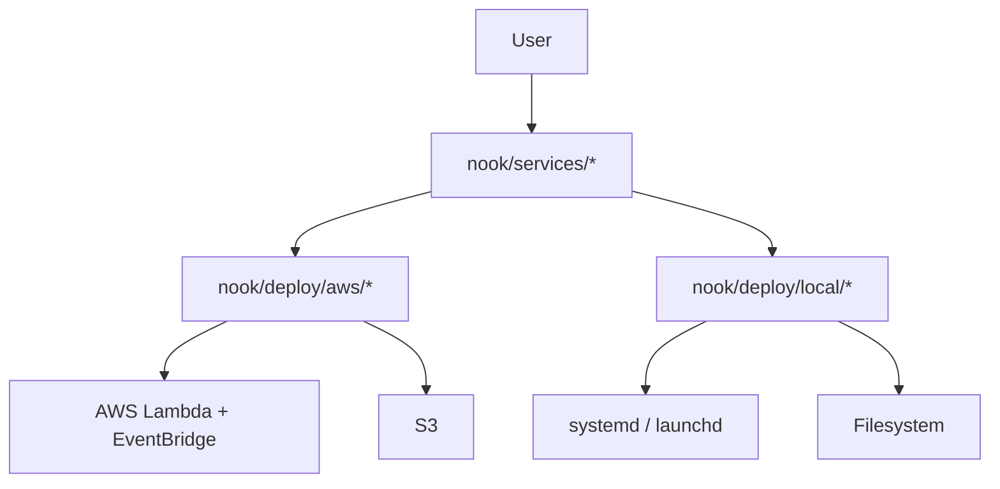

<p align="center">

<br>
</p>
<p align="right"><small><i>Logo generated by Claude 3.7 Sonnet</i></small></p>

<p align="center">
  <b>ブログ記事・Reddit投稿・GitHub動向・論文を毎日自動収集・要約するWebアプリ</b>
  <br>
  <br>
  
</p>

## 🌟 概要

Nookは、テック系の最新情報を自動的に収集し、要約するWebアプリです。

Reddit、Hacker News、GitHub Trending、技術ブログ、学術論文など多様な情報源から毎日自動的にコンテンツを収集し、LLMを使用して日本語で要約します。シンプルなWebインターフェースで閲覧でき、各トピックに対してチャット形式でフォローアップ質問も可能です。

1日平均12円の運用費*で情報収集にかかる時間を大幅に削減します。

## 🎬 外観

### PC

<p align="center">
  
</p>

### モバイル

<p align="center">
  
</p>

## ✨ 特徴

### 🔄 多様な情報源からの自動収集・要約
- **Hacker News**: Hacker Newsから最新のテクノロジーニュースと議論を収集
- **GitHub Trending**: GitHubで各言語ごとの人気リポジトリを取得
- **Reddit**: r/MachineLearningなどのサブレディットから人気投稿を収集して要約
- **RSS**: 技術ブログなどのRSSフィードを監視し、更新があれば取得して要約
- **Google Alerts**: 指定したキーワードに関するGoogle検索の新着結果を収集して要約
- **arXiv論文**: HuggingFaceでキュレーションされた最新の学術論文を自動収集し、HTMLページがあれば論文ごと読んで要約
- **Product Hunt**: Product Huntから最新のプロダクト情報を収集
- **Tech News**: TechCrunch (AI, Apps, Funding) と 36kr (AI, Apps, Funding関連) から記事を収集して要約

### 💬 インタラクティブなチャット機能
- **フォローアップ質問**: 要約された内容について、さらに詳しく質問可能（グラウンディングあり）

### 🌐 シンプルなWebインターフェース
- **日付別整理**: 収集した情報を日付ごとに整理して表示
- **レスポンシブデザイン**: モバイルデバイスでも快適に閲覧可能

### 🔧 簡単なデプロイと拡張性
- **AWS CDK**: インフラをコードとして管理し、簡単にデプロイ
- **モジュラー設計**: 新しい情報源の追加が容易
- **カスタマイズ可能**: 設定ファイルの編集で情報源を変更可能

## 🚀 導入方法

### 前提条件

<details>
<summary>必要なツール（クリックして展開）</summary>

- `uv`
  - 依存管理、local service 実行、`cdk.json` 経由の `app.py` 実行に使います。
- `gh` (GitHub CLI)
  - Codex ベースの PR 作成・レビュー対応に使用します。
- Python 3.11
- 以下のAPIキー:
  - Google Gemini API キー（有償）
  - Reddit API キー（クライアントID、クライアントシークレット）
  - Product Hunt API Key
  - Product Hunt Developer Token
- Google アカウント（Google AlertsのRSSフィード設定用）
- AWS で動かす場合のみ:
  - AWS CLI
  - AWS CDK
  - `aws configure` 済みの認証情報

</details>

### クイックスタート

1. **リポジトリをクローン**
   ```bash
   git clone https://github.com/discus0434/nook.git
   cd nook
   ```

2. **環境変数の設定**
   `.env.example` をコピーして `.env` を作成
   ```bash
   cp .env.example .env
   ```
   `.env` に以下の値を設定
   ```dotenv
   GEMINI_API_KEY=your_gemini_api_key
   GEMINI_MODEL=gemini-2.5-flash
   REDDIT_CLIENT_ID=your_reddit_client_id
   REDDIT_CLIENT_SECRET=your_reddit_client_secret
   REDDIT_USER_AGENT=your_reddit_user_agent
   PRODUCT_HUNT_API_KEY=your_product_hunt_api_key
   PRODUCT_HUNT_DEVELOPER_TOKEN=your_product_hunt_developer_token
   # Optional: override the AWS Secrets Manager secret name
   NOOK_AWS_SECRET_ID=my-nook/runtime-secrets
   ```

3. **依存関係のインストール**
   ```bash
   uv sync --dev
   ```

4. **ローカル品質チェック**
   ```bash
   make post-change
   ```

5. **ローカル macOS / Ubuntu service として登録**
   ```bash
   make local-register
   ```

   collector を手動で 1 本だけ発火したいときは:
   ```bash
   make local-trigger SERVICE=reddit_explorer
   ```

6. **または AWS に一発デプロイ**
   ```bash
   make cdk-deploy
   ```
   `make cdk-deploy` は repo root の `.env` と process env を merge したうえで、
   `NOOK_AWS_SECRET_ID` で指定された Secrets Manager secret へ credential を反映してから deploy します。
   `cdk-synth` / `cdk-diff` / `cdk-deploy` の template には raw secret 値は含まれません。

7. **アプリにアクセス**
   - local: `http://127.0.0.1:8080`
   - AWS: デプロイ完了後に表示される `viewer` Function URL

## 🏗️ アーキテクチャ



- core logic は `nook/services/` に集約されています。
- AWS 側は `nook/deploy/aws/handlers/` と `nook/deploy/aws/stack.py` が担当します。
- AWS runtime credential は Secrets Manager から解決し、Lambda environment には runtime metadata と secret identifier に加えて必須の `GEMINI_MODEL` を渡します。
- local 側は `nook/deploy/local/cli.py` が manifest 生成、register/unregister、viewer 起動、collector 起動を担当します。
- local service manifest は absolute `uv` path を保持し、systemd collector は `TimeoutStartSec=15min` で実行します。
- collector / viewer は共通の storage abstraction を通して、local では filesystem backend、AWS では S3 backend を使います。
- Gemini のモデル指定は `.env` の `GEMINI_MODEL` が必須で、local / AWS の両方で同じ値を使います。未設定なら fail-fast します。
- Gemini summary が書式に依存する collector では、model からは structured output を受け取り、アプリ側 renderer が Markdown に整形します。現時点では `paper_summarizer` と `reddit_explorer` がこの経路です。
- TOML ベースの collector 設定は package 内ではなく `configs/<service>/` 配下に置き、runtime では共通 loader から参照します。
- viewer の retry は既存 Markdown の有無ではなく、更新時刻が進んだことを見て完了判定します。
- viewer の chat は service 全体ではなく article 単位で動き、client が送る `article_id` / `date` をもとに server 側で対象 article を再解決します。`article_id` は article content fingerprint を種にした per-instance ID で、service/date ごとの state に保存して reload / retry 後も可能な限り再利用します。
- `make cdk-synth` / `make cdk-diff` / `make cdk-deploy` は stale な `cdk.out` を削除してから実行します。

## 🛠️ カスタマイズ

### 情報源の追加・変更

各情報源は設定ファイルまたはコード内で管理されており、カスタマイズできます:

#### Reddit

`configs/reddit_explorer/subreddits.toml` を編集して、収集するサブレディットを変更できます。

```toml
[[subreddits]]
name = "MachineLearning"

# 新しいサブレディットを追加
[[subreddits]]
name = "LocalLLaMA"
```

#### GitHub Trending

`configs/github_trending/languages.toml` を編集して、追跡するプログラミング言語を変更できます。

```toml
[[languages]]
name = "python"

# 新しい言語を追加
[[languages]]
name = "javascript"
```

#### 技術ブログ

`configs/tech_feed/feed.toml` を編集して、RSSフィードを追加/変更できます。

```toml
[[feeds]]
key = "new_blog"
name = "My Favorite Tech Blog"
url = "https://example.com/feed.xml"
```

#### Tech News

`nook/services/tech_news/service.py` 内の `Config` クラスを編集して、TechCrunch や 36kr のフィードURLやフィルタリングキーワードを変更できます。

```python
class Config:
    # ... other settings ...
    keywords_to_filter = [ # キーワードを追加・削除
        "ai", "artificial intelligence", "app", "funding", "融资", "人工智能", "new keyword"
    ]

    feeds: list[FeedConfig] = [
        {
            "name": "TechCrunch-AI",
            "url": "https://techcrunch.com/category/artificial-intelligence/feed/",
            "keywords": None,
            "feed_name_display": "TechCrunch AI"
        },
        # 他のTechCrunchフィード...
        {
            "name": "36Kr-News",
            "url": "https://36kr.com/feed-article",
            "keywords": keywords_to_filter, # キーワードフィルタを適用
            "feed_name_display": "36Kr"
        },
        # 新しいフィードを追加
        # {
        #     "name": "NewSource-Topic",
        #     "url": "https://newsource.com/topic/feed",
        #     "keywords": keywords_to_filter, # または None
        #     "feed_name_display": "New Source Topic"
        # },
    ]

```

#### Google Alerts

`configs/google_alerts/google_alerts.toml` を編集して、監視したいキーワードのGoogleアラートRSSフィードを追加/変更できます。

1.  [Google アラート](https://www.google.com/alerts) にアクセスします。
2.  目的のキーワードでアラートを作成します。
3.  アラートのオプションで「配信先」を「RSSフィード」に設定します。
4.  作成されたアラートの横にあるRSSアイコンをクリックし、表示されるフィードのURLをコピーします。
5.  コピーしたURLを `configs/google_alerts/google_alerts.toml` に追加します。

```toml
# 例:
[[alerts]]
name = "監視したいキーワード"
url = "ここにコピーしたRSSフィードのURLを貼り付け"

[[alerts]]
name = "別のキーワード"
url = "別のRSSフィードURL"
```

### UI設定

viewer の見た目や挙動は以下を編集してカスタマイズできます。

- `nook/services/viewer/templates/index.html`: HTML の骨組みと初期表示の server-side render
- `nook/services/viewer/static/viewer.css`: スタイル
- `nook/services/viewer/static/viewer.js`: クライアント側の状態管理と描画

## 🧑‍💻 開発フロー

### Codex前提の運用ファイル

- `AGENTS.md`: このリポジトリで Codex / AGENT が従うルール
- `.codex/config.toml`: Codex のローカル設定
- `.codex/skills/`: repo-local skill 群
- `docs/`: 現況の設計・運用ドキュメント
- `specs/`: 中規模以上の変更時に一時的に置く技術仕様書

### よく使うコマンド

```bash
uv sync --dev
make post-change
make test ARGS='-k config'
make local-register
make local-trigger SERVICE=tech_feed
make cdk-synth
make cdk-diff
make cdk-deploy
```

`cdk.json` は `uv run python app.py` を使うので、CDK 実行時に追加の仮想環境 activation は不要です。

### テストの考え方

- 自動テストは `tests/unit/` のみを `pytest` で収集します。
- `tests/test_*.py` にある既存のネットワーク/API確認用スクリプトは手動チェック用途として残しています。
- 手動チェックは以下のターゲットから実行できます。

```bash
make manual-feed
make manual-rss
make manual-tech-news-feeds
make manual-product-hunt
```

### 仕様駆動フロー

- 変更が中規模以上になる場合は `specs/TEMPLATE.md` をコピーして技術仕様書を作成します。
- 実装後は `make spec-review` / `make spec-implementation-review` で Codex に read-only レビューさせる前提です。
- docs は追記ではなく上書きで最新状態に保ち、変更履歴は Git history / PR / Issue で追います。
- spec は作業中だけ `specs/` に置き、完了後は削除します。

## 🔄 使用例

### 日々のテックニュース収集

朝一番にNookにアクセスすれば、昨日1日のうちに発生した以下の情報をだいたい把握できます：

- 🔥 Redditで話題になっている最新の技術トピック
- 📈 GitHub上で人気急上昇中のプロジェクト
- 📰 Hacker Newsの注目記事
- 📚 最新のAI研究論文と主要な発見
- 🌐 更新されたブログ記事

すべて日本語で要約されているため、短時間で効率的に情報をキャッチアップできます。

### フォローアップ質問

記事/リポジトリの詳細について追加で知りたいことがある場合は、チャットインターフェースを使ってフォローアップ質問が可能です。

<p align="center">
  
</p>

### API連携

Nookが収集した情報はS3へ日毎に保存されるので、他のアプリケーションやワークフローと連携することも可能です。

```python
import boto3
import json
from datetime import date

# S3からのデータ取得の例
s3 = boto3.client('s3')
date_str = date.today().strftime("%Y-%m-%d")
response = s3.get_object(
    Bucket="your-nook-bucket",
    Key=f"tech_feed/{date_str}.md"
)
content = response["Body"].read().decode("utf-8")
print(content)
```

## 📄 ライセンス

このプロジェクトはGNU Affero General Public License v3.0の下で公開されています。詳細は [LICENSE](LICENSE) ファイルを参照してください。

## 📬 お問い合わせ

- GitHub Issues: 質問、バグ報告、機能リクエスト
- X: [@IMG_5955](https://x.com/IMG_5955)

<p><small>[*]ただし、使用状況や設定によって費用が変動する可能性があり、実際のコストは保証できません。自己責任での使用をお願いします。</small></p>
